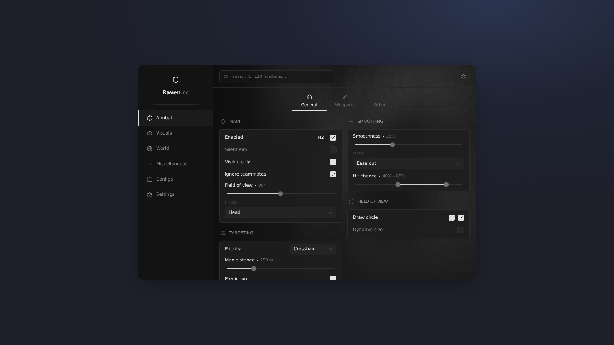

# UI Repo

A collection of UI libraries for Roblox executors. Each library lives in its own folder and loads with a single `loadstring`.

> **Made with AI.** Every library here was written with [Claude](https://claude.ai) (Anthropic), recreated from screenshots of UI designs and tested against a mock of the Roblox API. Expect rough edges, and please open an issue if something breaks in your executor.

## Libraries

| | UI | Style | Load |
| --- | --- | --- | --- |
|  | [**Raven**](raven/) | Dark and minimal: sidebar tabs, sub-tabs, ESP preview, Lucide icons | `raven/Library.lua` |

## Usage

Load a library:

```lua
local Library = loadstring(game:HttpGet("https://raw.githubusercontent.com/ImLiwo/ui-repo/main/raven/Library.lua"))()
```

Or run its demo, which builds every page:

```lua
loadstring(game:HttpGet("https://raw.githubusercontent.com/ImLiwo/ui-repo/main/raven/Example.lua"))()
```

Swap `raven` for another folder to use a different UI as more are added. Each folder's README has the full API.

## Shared basics

All the libraries follow the same pattern:

- `Library:CreateWindow(opts)`, then `Window:AddTab()`, `Tab:AddSubTab()`, `SubTab:AddSection()`
- Controls take a flag first: `Section:AddToggle("Flag", { Text = "...", Default = true })`
- Every control returns a controller with `:Get()`, `:Set()`, `:SetVisible()` and `:OnChanged(fn)`
- Values live in `Library.Flags`, controllers in `Library.Options`
- JSON configs (`SaveConfig` / `LoadConfig`), notifications, keybinds, colour pickers, themes
- `Library:Unload()` disconnects and destroys everything

## Folder layout

```
<ui-name>/
  Library.lua   the library
  Example.lua   a demo that rebuilds every page
  preview.png   a screenshot of the UI
  README.md     the API for that UI
```

## Notes

- Roblox can't detect mouse buttons 4 and 5, so mouse keybinds are limited to MB1 to MB3.
- Previews are approximate renders made outside Roblox, so fonts and effects differ slightly in game.
- These are independent recreations of UI designs and aren't affiliated with the original projects.
