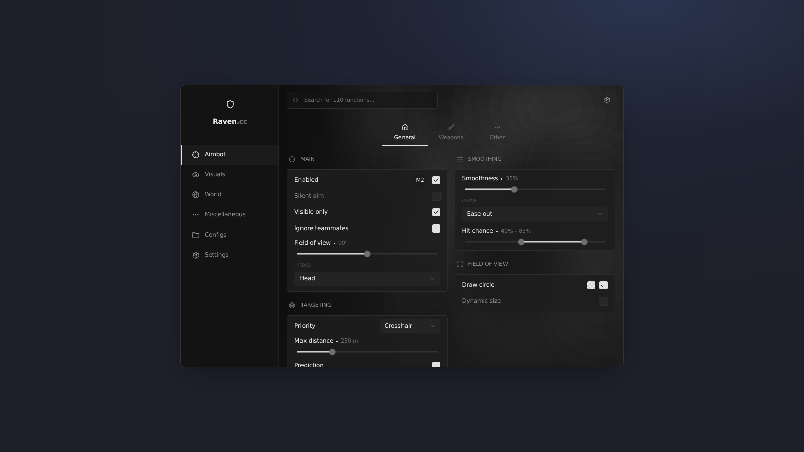

# Raven UI

A dark, minimal UI library for Roblox executors, inspired by the Raven.cc menu. You get a sidebar with tabs and sub-tabs, two-column sections, and a full set of controls. It also includes config saving, notifications, a watermark, a keybind list, a live ESP preview, and Lucide icons.

> **Made with AI.** This library was written with [Claude](https://claude.ai) (Anthropic) from screenshots of the original menu, then tested against a mock of the Roblox API. Expect rough edges, and please open an issue if something breaks in your executor.



## Features

- Sidebar tabs, sub-tabs, and left/right sections, with a search bar that finds any control
- Toggles with an inline keybind or colour picker
- Sliders with steps, suffixes, and ranges; click the value to type it
- Dropdowns: single or multi-select, searchable, refreshable
- Text boxes, buttons, labels, paragraphs, dividers, colour swatches, and list boxes
- Keybinds: Toggle, Hold, or Always mode, mouse buttons, and Backspace/Escape to clear
- Full colour picker with saturation/value, hue, alpha, hex/RGB, rainbow, and copy/paste
- An ESP preview that shows your own Roblox avatar, with box, health, armour, name, weapon, distance, and flags
- Notifications, a watermark (FPS and ping), a floating keybind list, and tooltips
- JSON configs with save, load, delete, and autoload, plus ready-made Configs and Settings tabs
- A theme engine with accent colours, fonts, UI scale, and animations on or off
- [Lucide](https://lucide.dev) icons, so any Lucide name works, with drawn icons as a fallback
- Safe mounting (`gethui`, then `CoreGui`, then `PlayerGui`) and a clean `Unload()` that disconnects everything

## Install

```lua
local Library = loadstring(game:HttpGet("https://raw.githubusercontent.com/ImLiwo/ui-repo/main/raven/Library.lua"))()
```

To run the full demo that rebuilds every page of the original menu:

```lua
loadstring(game:HttpGet("https://raw.githubusercontent.com/ImLiwo/ui-repo/main/raven/Example.lua"))()
```

While you edit the library locally, save it to your executor workspace as `Raven/Library.lua`. `Example.lua` uses that file instead of downloading.

## Quick start

```lua
local Window = Library:CreateWindow({
    Title = "Raven",
    Suffix = ".cc",
    Logo = "shield",
    Keybind = "Insert",          -- opens and closes the menu
    ConfigFolder = "MyScript",
})

local Aimbot  = Window:AddTab({ Name = "Aimbot", Icon = "crosshair" })
local General = Aimbot:AddSubTab({ Name = "General", Icon = "house" })
local Main    = General:AddSection({ Name = "Main", Icon = "crosshair", Side = "Left" })

Main:AddToggle("AimEnabled", { Text = "Enabled", Default = true })
    :AddKeybind("AimKey", { Default = "MB2", Mode = "Hold" })

Main:AddSlider("AimFov", { Text = "Field of view", Min = 0, Max = 180, Default = 90, Suffix = "°" })
Main:AddDropdown("AimHitbox", { Text = "Hitbox", Values = { "Head", "Chest", "Pelvis" }, Default = "Head" })

Library.Options.AimFov:OnChanged(function(value)
    print("FOV is now", value)
end)

Window:AddConfigsTab()
Window:AddSettingsTab()
```

## API overview

Every control returns a controller with `:Get()`, `:Set(value)`, `:SetVisible(bool)`, `:SetDisabled(bool)` and `:OnChanged(fn)`. The first argument is the flag. Values live in `Library.Flags[flag]` and controllers in `Library.Options[flag]`. Pass `Callback = function(value) end` in the options for a quick hook.

### Layout

| Call | Notes |
| --- | --- |
| `Library:CreateWindow(opts)` | `Title`, `Suffix`, `Logo`, `Keybind`, `ConfigFolder`, `Size` |
| `Window:AddTab({ Name, Icon })` | Sidebar entry |
| `Tab:AddSubTab({ Name, Icon })` | Optional; tabs without sub-tabs work too |
| `Tab/SubTab:AddSection({ Name, Icon, Side })` | `Side = "Left"` or `"Right"` |
| `Window:AddConfigsTab()` / `Window:AddSettingsTab()` | Ready-made pages |

### Controls (called on a section)

| Call | Key options |
| --- | --- |
| `AddToggle(flag, opts)` | `Text`, `Default`, `Tooltip`; chain `:AddKeybind()` / `:AddColorPicker()` |
| `AddSlider(flag, opts)` | `Min`, `Max`, `Default`, `Increment`, `Suffix`, `Range` |
| `AddDropdown(flag, opts)` | `Values`, `Default`, `Multi`, `Searchable`, `Inline`, `AllowNull`; `:Refresh(values)` |
| `AddTextbox(flag, opts)` | `Default`, `Placeholder`, `Numeric`, `ClearTextOnFocus` |
| `AddKeybind(flag, opts)` | `Default`, `Mode` (`Toggle`/`Hold`/`Always`), `Modes`, `Pressed` |
| `AddColorPicker(flag, opts)` | `Default`, `Transparency`, `Rainbow` |
| `AddButton(opts)` | `Text`, `Callback`, `Style` (`Primary`/`Secondary`/`Danger`), `DoubleClick`; `:AddButton()` for a split row |
| `AddLabel`, `AddParagraph`, `AddDivider`, `AddSpacer` | Static content |
| `AddSwatches`, `AddList` | Colour presets and a selectable list |
| `AddESPPreview(opts)` | `Avatar` (user id), `Weapon`, `Distance`, `Health`, `Armor`, `Flags`; `:Bind(element, toggle)` |

### Library

| Call | Notes |
| --- | --- |
| `Library:Notify({ Title, Content, Type, Duration })` | `Type`: `Info`, `Success`, `Warning`, `Error` |
| `Library:SaveConfig(name)` / `LoadConfig` / `DeleteConfig` / `ListConfigs()` | JSON in `<ConfigFolder>/configs` |
| `Library:SetAutoload(name)` / `LoadAutoload()` | Load a config on start |
| `Library:SetAccent(color)` / `SetTheme(tbl)` / `ResetTheme()` / `SetFont(font)` | Theming |
| `Library:SetWatermarkVisible(bool)` / `SetKeybindListVisible(bool)` | Widgets |
| `Library:SetMenuKey(key)` / `SetPanicKey(key)` / `Toggle()` | Menu control |
| `Library:OnUnload(fn)` / `Unload()` | Clean shutdown |

### Icons

Any [Lucide](https://lucide.dev/icons) name works wherever an `Icon` is accepted, for example `Icon = "skull"`. The sprite sheets come from [lucide-roblox-direct](https://github.com/deividcomsono/lucide-roblox-direct) on first load. If they can't load, the library falls back to its built-in drawn icons. Set `Library.UseLucide = false` to always use the drawn ones, or `Library.Icons.Register(name, fn)` to add your own.

## Notes

- Roblox can't detect mouse buttons 4 and 5, so mouse keybinds are limited to MB1 to MB3.
- The ESP preview is only a preview. It shows how the ESP will look and doesn't draw anything in the game.

## Credits

- Design inspired by the Raven.cc menu. This is an independent recreation.
- Icons: [Lucide](https://lucide.dev) (ISC), with Roblox sprite sheets from lucide-roblox-direct.
- Written with AI ([Claude](https://claude.ai) by Anthropic).
