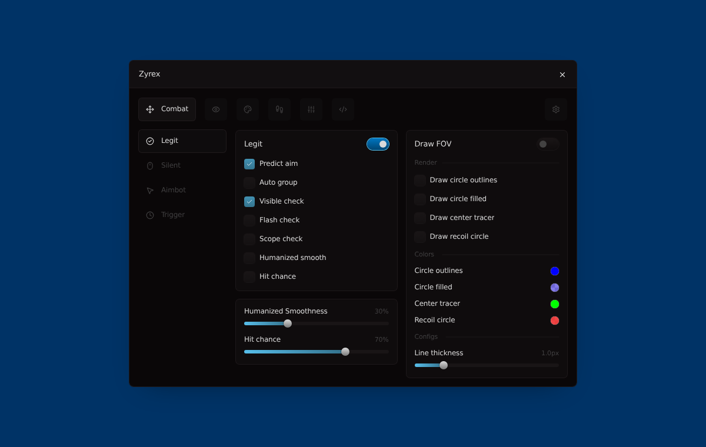

# Zyrex UI

A dark UI library for Roblox executors, recreated from the "Zyrex" menu. It has an icon tab bar where the active tab grows to show its name, a sub-tab column on the left, and two columns of bordered cards. Cards can have a switch in their header. Inside them you get blue gradient checkboxes, sliders, captioned dividers and round colour swatches. It also includes config saving, notifications, a watermark, a keybind list, tooltips, an ESP preview and a live theme engine.

> **Made with AI.** This library was written with [Claude](https://claude.ai) (Anthropic) from a screenshot of the original menu, then tested against a mock of the Roblox API. Expect rough edges, and please open an issue if something breaks in your executor.



## Features

- Icon tab bar (active tab shows its name, inactive tabs show a tooltip), with tabs on the left or right (`Align = "Right"`, like the gear)
- Sub-tab column; tabs without sub-tabs get a full-width page
- Cards with an optional title and an optional header switch (`Toggle = true`); untitled cards for loose sliders
- Checkbox toggles (default) or pill switches (`Style = "Switch"`), each with an inline keybind or colour picker
- Sliders with a gradient fill, steps (`1`, `0.1`, `0.01`), suffixes (`%`, `px`, `ms`, `studs`), ranges, and click-the-value-to-type
- Dropdowns: single or multi-select, a search bar on long lists, `:Refresh(values)`
- Text boxes, buttons (Primary, Secondary, Danger, split rows, double-click confirm), labels, paragraphs, captioned dividers
- Keybinds: Toggle, Hold or Always mode, mouse buttons, Backspace/Escape to clear
- Colour picker with saturation/value, hue, alpha, hex/RGB, rainbow, and copy/paste
- Notifications, a draggable watermark (FPS, ping, config), a draggable keybind list, and tooltips
- JSON configs (save, load, delete, autoload) and a ready-made Settings tab with a Configs sub-tab
- Theme engine: change the accent and the switch, checkbox and slider shades follow live
- Safe mounting (`gethui`, then `cloneref(CoreGui)`, then `PlayerGui`) and a clean `Unload()`

## Install

```lua
local Library = loadstring(game:HttpGet("https://raw.githubusercontent.com/ImLiwo/ui-repo/main/zyrex/Library.lua"))()
```

To run the full demo, which rebuilds the reference page and fills every other tab, save `Library.lua` to your executor's workspace folder as `Zyrex/Library.lua`, then run `Example.lua`. It loads the library from that local file (change `LIBRARY_PATH` on line 18 to use another path).

## Quick start

```lua
local Window = Library:CreateWindow({
    Title = "Zyrex",
    Keybind = "Insert",       -- opens and closes the menu
    ConfigFolder = "MyScript",
})

local Combat = Window:AddTab({ Name = "Combat", Icon = "move" })
local Legit  = Combat:AddSubTab({ Name = "Legit", Icon = "circle-check" })

-- a card with a switch in its header
local Main = Legit:AddSection({ Name = "Legit", Side = "Left", Toggle = true, Flag = "LegitEnabled", Default = true })
Main:AddToggle("PredictAim", { Text = "Predict aim", Default = true })
Main:AddToggle("VisibleCheck", { Text = "Visible check", Default = true })

-- a card with no title
local Tune = Legit:AddSection({ Side = "Left" })
Tune:AddSlider("HitChance", { Text = "Hit chance", Min = 0, Max = 100, Default = 70, Suffix = "%" })

local Fov = Legit:AddSection({ Name = "Draw FOV", Side = "Right", Toggle = true, Flag = "DrawFov" })
Fov:AddDivider("Colors")
Fov:AddLabel("Circle outlines"):AddColorPicker("FovColor", { Default = Color3.fromRGB(0, 0, 255) })

Library.Options.HitChance:OnChanged(function(value)
    print("Hit chance is now", value)
end)

Window:AddSettingsTab()   -- gear on the right, with General and Configs sub-tabs
```

## API overview

Every control returns a controller with `:Get()`, `:Set(value)`, `:SetVisible(bool)`, `:SetDisabled(bool)` and `:OnChanged(fn)`. The first argument is the flag. Values live in `Library.Flags[flag]` and controllers in `Library.Options[flag]`. Pass `Callback = function(value) end` in the options for a quick hook, and `DependsOn = "Flag"` to dim a control while another toggle is off.

### Layout

| Call | Notes |
| --- | --- |
| `Library:CreateWindow(opts)` | `Title`, `Keybind`, `ConfigFolder`, `Size` (default 760 x 554), `Resizable`, `CloseBehavior` (`"Hide"` or `"Unload"`) |
| `Window:AddTab({ Name, Icon, Align })` | Icon tab; `Align = "Right"` pins it to the right |
| `Tab:AddSubTab({ Name, Icon })` | Optional; without sub-tabs the page spans the window |
| `Tab/SubTab:AddSection(opts)` | `Name` (omit for an untitled card), `Side`, `Toggle`, `Flag`, `Default`, `Callback` |
| `Window:AddSettingsTab(opts)` / `Window:AddConfigsTab(opts)` | Ready-made pages; `Configs = false` skips the Configs sub-tab |
| `Window:Search(text)` / `Window:Reveal(control)` | Find controls by name and jump to one |

The title bar drags the window, a double click minimises it, and the X hides it (the menu key brings it back).

### Controls (called on a section)

| Call | Key options |
| --- | --- |
| `AddToggle(flag, opts)` | `Text`, `Default`, `Style` (`"Checkbox"` or `"Switch"`), `Tooltip`; chain `:AddKeybind()` / `:AddColorPicker()` |
| `AddSwitch(flag, opts)` | Same as a toggle with `Style = "Switch"` |
| `AddSlider(flag, opts)` | `Min`, `Max`, `Default`, `Increment`, `Suffix`; a `{ lo, hi }` default makes a range |
| `AddDropdown(flag, opts)` | `Values`, `Default`, `Multi`, `Searchable`, `Inline`, `AllowNull`; `:Refresh(values)` |
| `AddTextbox(flag, opts)` | `Default`, `Placeholder`, `Numeric`, `ClearTextOnFocus` |
| `AddLabel(text)` | Chain `:AddColorPicker()` or `:AddKeybind()` for a swatch or key on the right |
| `AddKeybind(flag, opts)` | `Default`, `Mode` (`Toggle`/`Hold`/`Always`) |
| `AddColorPicker(flag, opts)` | `Default`, `Transparency`, `Rainbow` |
| `AddButton(opts)` | `Text`, `Callback`, `Style` (`Primary`/`Secondary`/`Danger`), `DoubleClick`; `:AddButton()` for a split row |
| `AddDivider(text?)` | A line, or a muted caption followed by a line |
| `AddParagraph`, `AddSpacer`, `AddSwatches`, `AddList` | Static text, spacing, colour presets, a selectable list |
| `AddESPPreview(opts)` | `Weapon`, `Distance`, `Health`, `Armor`, `Flags`; `:Bind(element, toggle)` |

### Library

| Call | Notes |
| --- | --- |
| `Library:Notify({ Title, Content, Type, Duration })` | `Type`: `Info`, `Success`, `Warning`, `Error` |
| `Library:SaveConfig(name)` / `LoadConfig` / `DeleteConfig` / `ListConfigs()` | JSON in `<ConfigFolder>/configs` |
| `Library:SetAutoload(name)` / `LoadAutoload()` | Load a config on start |
| `Library:SetAccent(color)` / `SetTheme(tbl)` / `ResetTheme()` / `SetFont(font)` | Theming; `Library.Theme` holds every token |
| `Library:SetWatermarkVisible(bool)` / `SetKeybindListVisible(bool)` / `SetNotifyPosition(side)` | Widgets |
| `Library:SetMenuKey(key)` / `SetPanicKey(key)` / `Toggle()` | Menu control |
| `Library:OnUnload(fn)` / `Unload()` | Clean shutdown |

### Icons

Any [Lucide](https://lucide.dev/icons) name works wherever an `Icon` is accepted. The sprite sheets come from [lucide-roblox-direct](https://github.com/deividcomsono/lucide-roblox-direct) on first load. If they can't load, the library falls back to built-in drawn icons. Set `Library.UseLucide = false` to always use the drawn ones.

## Notes

- Roblox can't detect mouse buttons 4 and 5, so mouse keybinds are limited to MB1 to MB3.
- The reference uses filled icons; Lucide icons are outlined, so the tab icons look a little lighter.
- The preview is a render made outside Roblox, so fonts differ slightly in game.

## Credits

- Design based on the Zyrex menu. This is an independent recreation and isn't affiliated with it.
- Icons: [Lucide](https://lucide.dev) (ISC), with Roblox sprite sheets from lucide-roblox-direct.
- Written with AI ([Claude](https://claude.ai) by Anthropic).
